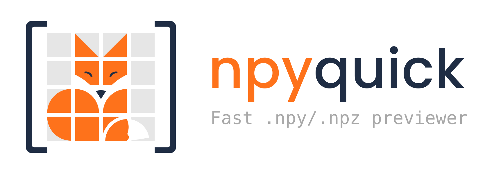
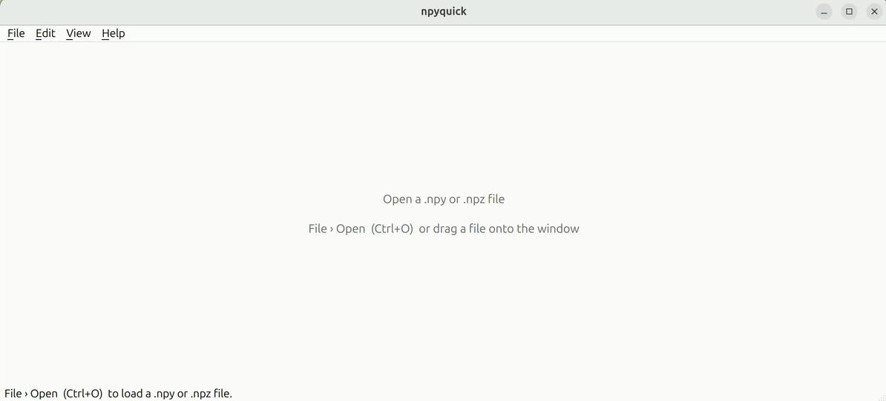
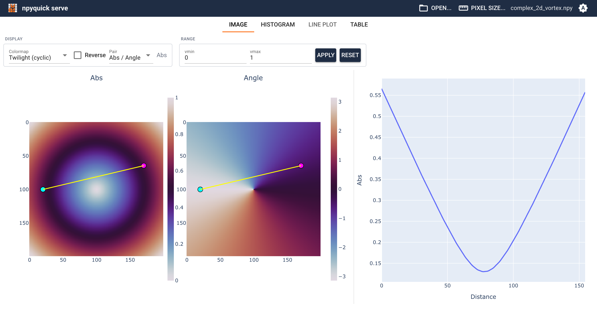
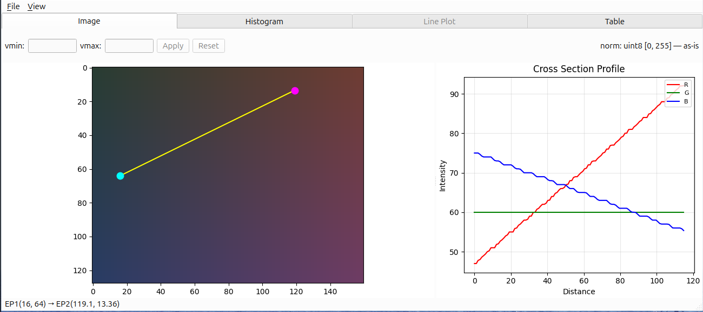
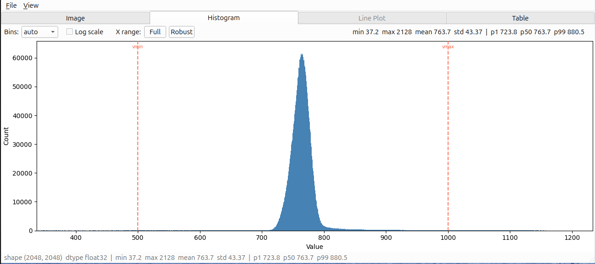
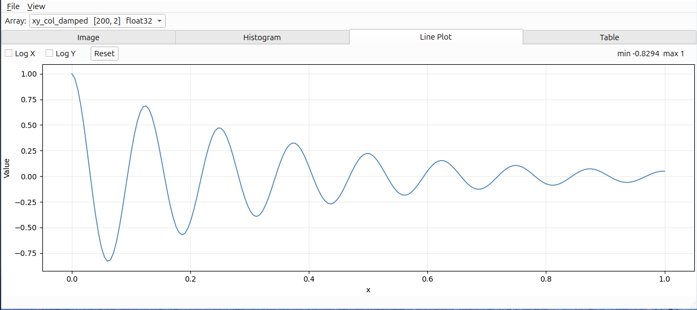
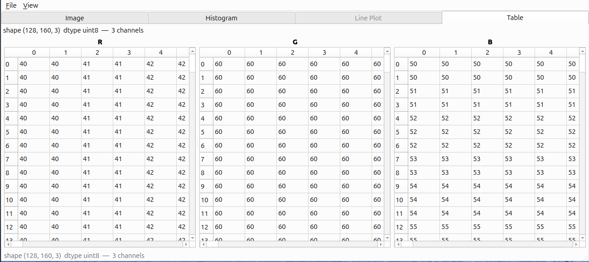
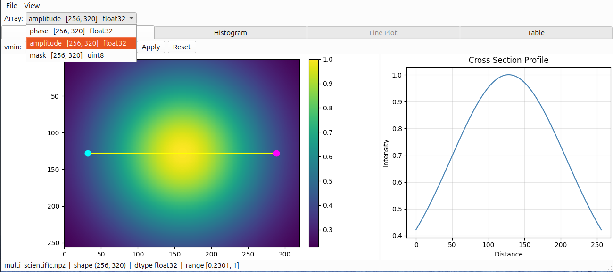

<p align="center">
  <picture>
    <source media="(prefers-color-scheme: dark)" srcset="https://raw.githubusercontent.com/LiukDiihMieu/npyquick/main/docs/assets/logo-horizontal-dark.svg">
    <source media="(prefers-color-scheme: light)" srcset="https://raw.githubusercontent.com/LiukDiihMieu/npyquick/main/docs/assets/logo-horizontal-light.svg">
    
  </picture>
</p>

<p align="center">
  <a href="https://pypi.org/project/npyquick/"></a>
  <a href="https://pypi.org/project/npyquick/"></a>
  <a href="https://github.com/LiukDiihMieu/npyquick/releases"></a>
  <a href="https://github.com/LiukDiihMieu/npyquick/releases"></a>
  <a href="https://snapcraft.io/npyquick"></a>
  <a href="LICENSE"></a>
</p>

## Why npyquick?

Researchers often need to quickly inspect .npy and .npz files without writing a notebook, launching an IDE, or remembering the array shape in advance.

npyquick is designed as a small, practical viewer for this job:

* open NumPy array files directly from the terminal or file manager
* inspect common scientific data layouts immediately
* stay lightweight and easy to understand
* avoid turning a simple array viewer into a full image-processing application

<p align="center">
  
</p>

## Installation

| Platform | Install with | |
| --- | --- | --- |
| Windows | Installer | Download `npyquick-<version>-setup.exe` from the [latest release](https://github.com/LiukDiihMieu/npyquick/releases/latest) |
| Linux | AppImage | Download `npyquick-<version>-x86_64.AppImage` from the [latest release](https://github.com/LiukDiihMieu/npyquick/releases/latest) |
| Ubuntu and other distributions with snap | Snap Store | `sudo snap install npyquick` |
| macOS, or any system with Python 3.10+ | uv or pipx | `uv tool install npyquick` or `pipx install npyquick` |

Each option is described below. Setting up double-click to open `.npy` / `.npz` files is covered in [Opening files by double-click](#opening-files-by-double-click).

### Windows

Run the installer. It installs per-user (no administrator rights needed) and adds a Start Menu shortcut. It also associates `.npy` and `.npz` files with npyquick so they open by double-click, unless you untick that option ([details](#windows-installer)).

The build is currently unsigned, so the first run may show a SmartScreen prompt. Download only from the official GitHub Releases page; after confirming the file name and source, choose *More info → Run anyway*.

### Linux: AppImage

For x86-64. Make the downloaded file executable, then run it:

```bash
chmod +x npyquick-*-x86_64.AppImage
./npyquick-*-x86_64.AppImage path/to/file.npy
```

To open files by double-click, register it once with `--install-desktop` ([details](#appimage-uv-pipx-or-pip-on-linux)).

### Linux: Snap

The Snap updates itself. It is sandboxed: it reads files in your home folder and, once you run `sudo snap connect npyquick:removable-media`, removable media. To open a file anywhere else — another drive, or a home folder that is a symlink to another disk — use **File › Open**, which reaches any file you pick.

Opening files by double-click needs a one-time setup ([details](#snap)).

### uv, pipx or pip

[uv](https://docs.astral.sh/uv/) and [pipx](https://pipx.pypa.io/) install npyquick into its own environment and put the `npyquick` command on your `PATH`. This is the way to install on macOS.

```bash
uv tool install npyquick      # or: pipx install npyquick
```

With uv you can also run it once without installing:

```bash
uvx npyquick path/to/file.npy
```

Inside a virtual environment or a conda environment, plain pip works too:

```bash
pip install npyquick
```

On Linux, `npyquick --install-desktop` then lets you open files by double-click ([details](#appimage-uv-pipx-or-pip-on-linux)). macOS has no such integration yet ([details](#macos)).

## Usage

```bash
npyquick                        # open GUI
npyquick path/to/file.npy       # open with a file
npyquick path/to/file.npz       # open a multi-array archive
```

Files can be opened via **File › Open** (`Ctrl+O`) or by **dragging and dropping** onto the window.

## Experimental web viewer

The desktop application remains the primary and recommended way to use npyquick. An optional web viewer is available as an experimental convenience for users who occasionally need to inspect remote `.npy` or `.npz` files in a browser.

The web viewer implements most of the desktop viewer's core functionality, but it may still contain bugs, is not guaranteed to provide complete feature parity, and may not immediately follow every desktop update.

Install the optional dependencies:

```bash
pip install "npyquick[serve]"
```

Start the viewer:

```bash
npyquick serve path/to/file.npy
```

Run `npyquick serve --help` for the available command-line options.



## Features

### Image view

Preview 2D grayscale arrays and RGB arrays with interactive zoom, pan, colormap control, brightness adjustment, and a draggable cross-section profile. Complex arrays are supported too, shown as two side-by-side panels: either real and imaginary parts, or absolute value and argument.



### Histogram view

Inspect value distributions with linear or log-scaled counts, robust range selection, summary statistics, and NaN / Inf reporting.



### Line Plot view

Display 1D signals and paired `(x, y)` arrays with interactive zoom, pan, reset, and optional log-scaled axes.



### Table view

Fallback preview for arrays that are not naturally displayed as images or line plots, including higher-dimensional, scalar, or empty arrays. Object arrays (`dtype=object`) are not supported.



### `.npz` archives

When a `.npz` archive contains multiple arrays, npyquick shows a key selector with each array's name, shape, and dtype. Switching the selected key reloads the active view.



For detailed display rules, normalization behavior, downsampling, and performance limits, see [Display behavior](docs/behavior.md).

## Keyboard shortcuts

| Shortcut         | Action                         |
| ---------------- | ------------------------------ |
| `Ctrl+O`         | Open file                      |
| `Ctrl+S`         | Export current figure          |
| `Ctrl+C`         | Copy current figure            |
| `Ctrl+Q`         | Quit                           |
| `F5` / `Ctrl+R`  | Reload current file            |
| `Ctrl+Tab`       | Switch to next enabled tab     |
| `Ctrl+Shift+Tab` | Switch to previous enabled tab |

On macOS, `⌘+Tab` is reserved by the system for app switching, so tab switching
uses `Control+Tab` / `Control+Shift+Tab` or `⌘+Shift+]` / `⌘+Shift+[` (as in Safari).

## Opening files by double-click

Register npyquick as the handler for `.npy` / `.npz` files so you can double-click them in your file manager, or right-click → Open With. How depends on how you installed npyquick.

### Windows installer

The installer associates `.npy` and `.npz` files with npyquick unless you untick *Associate .npy and .npz files with npyquick*. In 0.1.4 and earlier that option starts unticked, so tick it yourself. To change the choice later, run the installer again.

### AppImage, uv, pipx or pip on Linux

```bash
npyquick --install-desktop                          # uv, pipx or pip
./npyquick-*-x86_64.AppImage --install-desktop      # AppImage
```

If you integrate the AppImage with a tool like [AppImageLauncher](https://github.com/TheAssassin/AppImageLauncher), the association is set up for you and this step is not needed.

This installs a `.desktop` entry, the `.npy` / `.npz` MIME types, and the app icon under `~/.local/share` (user-level, no root). Then double-click a file, or test from the terminal:

```bash
xdg-open path/to/file.npy
```

To remove it:

```bash
npyquick --uninstall-desktop
```

Works on desktops that follow the freedesktop.org desktop-entry and MIME standards (GNOME, KDE Plasma, XFCE, Cinnamon, MATE). Some environments only show the new association after the file manager restarts or you log out and back in.

<details>
<summary>Manual setup</summary>

Create `~/.local/share/applications/io.github.liukdiihmieu.npyquick.desktop`, replacing the `Exec=` path with the output of `which npyquick`:

```ini
[Desktop Entry]
Type=Application
Name=npyquick
Comment=Open NumPy array files
Exec=/path/to/npyquick %f
Icon=io.github.liukdiihmieu.npyquick
Terminal=false
Categories=Science;Utility;
MimeType=application/x-npy;application/x-npz;
StartupNotify=true
```

Register the MIME types by creating `~/.local/share/mime/packages/npyquick.xml`:

```xml
<?xml version="1.0" encoding="UTF-8"?>
<mime-info xmlns="http://www.freedesktop.org/standards/shared-mime-info">
  <mime-type type="application/x-npy">
    <comment>NumPy array file</comment>
    <glob pattern="*.npy" weight="100"/>
  </mime-type>
  <mime-type type="application/x-npz">
    <comment>NumPy compressed archive</comment>
    <sub-class-of type="application/zip"/>
    <glob pattern="*.npz" weight="100"/>
  </mime-type>
</mime-info>
```

The `sub-class-of` and high glob weight matter for `.npz`: it is a ZIP container internally, so without them some desktops classify it as `application/zip` before the extension rule applies.

Then update the databases and set the default handler:

```bash
update-mime-database ~/.local/share/mime
update-desktop-database ~/.local/share/applications
xdg-mime default io.github.liukdiihmieu.npyquick.desktop application/x-npy
xdg-mime default io.github.liukdiihmieu.npyquick.desktop application/x-npz
```
</details>

### Snap

The Snap already ships the launcher and declares the `.npy` / `.npz` types, so you don't need to create a `.desktop` file — you only have to teach your system what those extensions are. Create `~/.local/share/mime/packages/npyquick.xml` (the same MIME file shown under *Manual setup* above), then:

```bash
update-mime-database ~/.local/share/mime
xdg-mime default npyquick_npyquick.desktop application/x-npy
xdg-mime default npyquick_npyquick.desktop application/x-npz
```

Double-clicking then works for files in your home folder (and connected removable media); for a file on another drive, use File › Open instead — the sandbox doesn't reach it.

### macOS

Not available yet: a uv, pipx or pip install has no Finder integration. Open files from the terminal, with **File › Open**, or by dragging them onto the window. Tracked in [#30](https://github.com/LiukDiihMieu/npyquick/issues/30).


## Contributing

Bug reports, feature requests, and suggestions are welcome — please open an [issue](https://github.com/LiukDiihMieu/npyquick/issues).

If an installed copy misbehaves, `npyquick --self-test` checks that it can load files and export plots, and prints a short report worth attaching to the issue. The Windows build has no console, so pass a file name to get the report: `npyquick.exe --self-test report.txt`.

To work on the code, install it in editable mode with the test dependencies and run the tests:

```bash
pip install -e ".[dev]"      # or: uv pip install -e ".[dev]"
pytest
```

> The code in this repository is primarily written by an AI coding agent and reviewed by a human maintainer.

## License

Copyright 2026 LiukDiihMieu

This project is licensed under the **GNU General Public License v3.0 or later**. Project logo and visual assets are included for use with this project.
See the [LICENSE](LICENSE) file for details.
